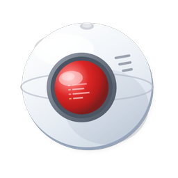

<h1> PodLogs</h1>

A native Rust desktop application for viewing and searching Kubernetes pod logs, built with GPUI and kube-rs.


## Overview

PodLogs connects to Kubernetes contexts in your kubeconfig and provides views for deployments, pods, pod logs, and deployment log search. The interface and Kubernetes client are implemented in Rust; log views refresh by polling at the configured interval.

## Features

- Switch between Kubernetes contexts and namespaces, with namespace selection remembered per context.
- Browse deployments and pods, inspect pod details, and view container logs.
- Search deployment logs across pods and filter by log level and time range.
- View parsed or raw log entries, inspect details, and export logs.
- Inspect labels, conditions, container configuration, and environment declarations. ConfigMap values are resolved from current configuration; Secret values remain masked.
- Choose light or dark theme, configure refresh intervals, and use virtualized log and search result lists.

## Screenshots

These screenshots are reference images from the earlier interface and may not match the current GPUI layout exactly.

<p align="center"></p>
<p align="center"></p>
<p align="center"></p>

## Releases and platform status

The `v2.0.0` version in this migration branch describes the full-Rust migration. It does not mean v2 installers have already been published. Check the [GitHub Releases](https://github.com/andrisasuke/podlogs/releases) page for artifacts that are actually available.

The release workflow is configured to produce macOS DMGs for Apple Silicon and Intel, Linux DEB and AppImage packages for amd64 and arm64, and a Windows x64 NSIS installer. macOS requires 12.0 (Monterey) or newer. These packaging targets are not all validated yet: Linux and Windows builds are pending CI and have not been manually tested; macOS packaging has been built locally, but installation and app behavior still need owner testing. macOS builds are unsigned and not notarized. The new Windows installer is unsigned, nonblocking in the release workflow, and may show a SmartScreen warning.

## Requirements

- A kubeconfig with access to the clusters you want to inspect, usually `~/.kube/config` (or the platform's standard Kubernetes config location).
- Network access to those Kubernetes clusters.
- Rust 1.99.1, selected by `rust-toolchain.toml`, for building from source.

## Build from source

```sh
git clone --branch andrisasuke/Rust-full-migrate https://github.com/andrisasuke/podlogs.git
cd podlogs
cargo run
cargo test --locked
cargo build --locked
```

`cargo run` starts the desktop app and requires a graphical session. The toolchain is pinned to Rust 1.99.1 and `gpui-kit` is pinned to `=0.9.1`; changes to either pin should be handled as a separate upgrade task.

## Install published packages

Use only installers actually published on the [GitHub Releases](https://github.com/andrisasuke/podlogs/releases) page or provided as CI artifacts. The migration branch's v2 packaging commands below do not mean these v2 installers are already available. The release workflow renames artifacts to these patterns; local `cargo packager` output may keep cargo-packager's default names.

| Platform | Artifact pattern | Install/use |
| --- | --- | --- |
| macOS | `PodLogs_<version>_macos_aarch64.dmg` or `PodLogs_<version>_macos_x64.dmg` | Open the DMG and drag PodLogs to Applications. Builds are unsigned and not notarized; Gatekeeper may require right-click > Open. |
| Linux | `PodLogs_<version>_linux_amd64.deb` or `PodLogs_<version>_linux_arm64.deb` | Install a DEB with `sudo dpkg -i <package.deb>`. The corresponding AppImage can be run with `chmod +x <package.AppImage>` followed by `./<package.AppImage>`. |
| Windows | `PodLogs_<version>_windows_x64-setup.exe` | Run the NSIS installer. It is unsigned and may show a SmartScreen warning. |

macOS installation and app behavior still need owner testing. Linux and Windows CI and manual checks are pending.

## Package for your platform

Install cargo-packager 0.11.8:

```sh
cargo install cargo-packager --version 0.11.8 --locked
```

Build the release binary before packaging; cargo-packager does not build it automatically. Run the commands on the target platform. If specifying a cross-compilation target, pass the same `--target` to both `cargo build` and `cargo packager`.

### macOS

macOS packaging requires Xcode Command Line Tools. The commands set the deployment target consistently and use cargo-packager's noninteractive DMG mode locally:

```sh
MACOSX_DEPLOYMENT_TARGET=12.0 cargo build --release --locked
CI=true MACOSX_DEPLOYMENT_TARGET=12.0 cargo packager --release --formats dmg
```

`CI=true` here selects noninteractive local packaging behavior; it does not run or trigger remote CI. The resulting app and DMG are unsigned and not notarized, so Gatekeeper may require opening the app through Finder's right-click > Open flow.

### Linux

Linux requires the GPUI windowing/graphics development libraries and packaging tools. On Ubuntu/Debian, install the libraries used by the release workflow before building:

```sh
sudo apt-get update
sudo apt-get install -y libxkbcommon-x11-dev libwayland-dev libx11-xcb-dev libfontconfig-dev libvulkan1 libxkbcommon-dev libx11-dev libxcb1-dev libxcb-render0-dev libxcb-shape0-dev libxcb-xfixes0-dev libxrandr-dev libxi-dev libxcursor-dev libxinerama-dev libgl1-mesa-dev libssl-dev pkg-config patchelf libfuse2
cargo build --release --locked
cargo packager --release --formats deb,appimage
```

### Windows

Build on Windows with the Rust MSVC toolchain and the required Windows build tools installed. The release workflow packages an x64 NSIS installer:

```powershell
cargo build --release --locked
cargo packager --release --formats nsis
```

The Windows packaging path is new and has not yet been validated by CI or manual testing.

## Project layout

```text
src/
  app/       GPUI screens, Store, queries, and view behavior
  k8s/       kube-rs client operations, including ConfigMap resolution
  models/    Kubernetes and log data models
  ui/        Shared widgets, theme, and tracked text
  api.rs     Api boundary and Kubernetes implementation
  main.rs    Application startup
assets/      App artwork and embedded fonts with OFL license files
icons/       Platform packaging icons
design/      Reference screenshots
```

## License and acknowledgments

PodLogs is licensed under the [MIT License](LICENSE). The bundled IBM Plex Sans and JetBrains Mono fonts retain their SIL Open Font License texts in `assets/fonts/OFL-IBMPlexSans.txt` and `assets/fonts/OFL-JetBrainsMono.txt`.

The application uses [GPUI](https://github.com/zed-industries/zed), [kube-rs](https://kube.rs/), and [Lucide](https://lucide.dev/) icons.
